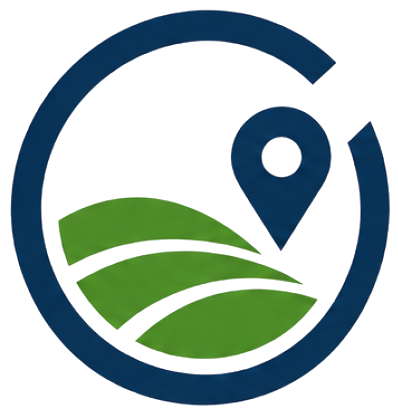

# Especificación de Diseño UI/UX y Arquitectura Semántica (Wireframe) — INGEOPREDIAL S.A.S.

> **Documento Oficial del Agente Diseñador UI/UX (`disenador`)**  
> Arquitectura de información, jerarquía visual Mobile-First, sistema de tokens CSS3, selección de activos gráficos e implementación semántica HTML5 alineada estrictamente con `directrices.md` y `copywriting.md`.

---

## 1. Sistema de Diseño y Tokens Visuales (CSS3 Custom Properties)

El diseño se rige por una estética **institucional, limpia, técnica y minimalista**, proyectando autoridad ingenieril y seguridad jurídica. El Agente Desarrollador debe declarar y emplear de forma obligatoria las siguientes variables en `:root`:

```css
:root {
  /* Paleta Corporativa Estricta (Obligatoria por Directrices) */
  --blanco-fondo: #ffffff;       /* Fondo principal de la página, tarjetas sobre fondo gris y textos sobre fondos oscuros */
  --gris-claro: #f4f7f6;         /* Alternancia de fondo en secciones (#nosotros, #contacto) y fondos de inputs para descanso visual */
  --azul-corporativo: #0d2b45;   /* Títulos (h1-h4), textos principales, Header, Overlay Hero (con opacidad) y Footer */
  --verde-corporativo: #2d8a39;  /* Exclusivo para botones CTA primarios, íconos SVG de servicios, badges y detalles de acento */

  /* Variaciones Funcionales Derivadas (Transparencias de la misma paleta) */
  --azul-overlay-hero: rgba(13, 43, 69, 0.78);      /* Overlay de Hero Section entre 75% y 80% de opacidad */
  --azul-texto-secundario: rgba(13, 43, 69, 0.82);  /* Párrafos de cuerpo para lectura descansada manteniendo identidad */
  --azul-borde-sutil: rgba(13, 43, 69, 0.12);       /* Líneas divisorias y bordes de tarjetas / inputs */
  --verde-acento-suave: rgba(45, 138, 57, 0.10);    /* Fondo tenue para contenedores de íconos SVG y etiquetas normativas */
  --verde-hover: #236e2d;                           /* Estado :hover / :focus para botones en --verde-corporativo */

  /* Tipografía y Ritmo Vertical */
  --font-principal: 'Inter', -apple-system, BlinkMacSystemFont, 'Segoe UI', Roboto, sans-serif;
  --font-titulos: 'Montserrat', 'Inter', sans-serif;
  --max-width-container: 1200px;
  --header-height-mobile: 72px;
  --header-height-desktop: 84px;
  --border-radius-card: 10px;
  --border-radius-btn: 6px;
  --shadow-card: 0 6px 24px rgba(13, 43, 69, 0.07);
  --shadow-card-hover: 0 12px 32px rgba(13, 43, 69, 0.14);
  --transition-base: all 0.28s cubic-bezier(0.4, 0, 0.2, 1);
}
```

### Reglas Globales de Comportamiento y Desplazamiento
- **Desplazamiento suave nativo:**
  ```css
  html {
    scroll-behavior: smooth;
    scroll-padding-top: var(--header-height-desktop); /* Evita que el Sticky Header oculte los títulos al navegar por anclas */
  }
  ```
- **Alternancia Cromática de Secciones (Descanso Visual):**
  1. `<header>`: Fondo `--blanco-fondo` (`#ffffff`) con borde inferior sutil `1px solid var(--azul-borde-sutil)` y sombra ligera al hacer scroll.
  2. `<section id="inicio">` (Hero): Imagen temática de fondo + Overlay `--azul-corporativo` al **78% de opacidad** (`rgba(13, 43, 69, 0.78)`), textos en `--blanco-fondo` (`#ffffff`) y acentos en `--verde-corporativo` (`#2d8a39`).
  3. `<section id="nosotros">`: Fondo `--gris-claro` (`#f4f7f6`).
  4. `<section id="servicios">`: Fondo `--blanco-fondo` (`#ffffff`), con tarjetas (`<article>`) en `--blanco-fondo` bordeadas y acentuadas con `--verde-corporativo`.
  5. `<section id="contacto">`: Fondo `--gris-claro` (`#f4f7f6`), con tarjeta de formulario en `--blanco-fondo` (`#ffffff`).
  6. `<footer>`: Fondo `--azul-corporativo` (`#0d2b45`), textos en `--blanco-fondo` (`#ffffff`) y detalles de acento en `--verde-corporativo` (`#2d8a39`).

---

## 2. Selección de Activos Visuales y URLs de Imágenes (Unsplash + Rutas Locales)

Siguiendo estrictamente la directriz de utilizar rutas relativas `./assets/images/` para el logo y fotografías técnicas de alta resolución (Unsplash) vinculadas exclusivamente a `topography`, `surveying`, `GNSS`, `blueprints` y `drone mapping`:

| Activo Visual | Ubicación en DOM | Ruta / URL Seleccionada | Atributo `alt` (según `copywriting.md`) |
| :--- | :--- | :--- | :--- |
| **Logo Corporativo (Header)** | `<header> .brand-logo img` | `./assets/images/logo-ingeopredial.png` *(PNG RGBA 398×412 px con fondo 100% transparente `alpha = 0`)* | `"Logo oficial de INGEOPREDIAL S.A.S. - Firma de Ingenieros Catastrales y Geodestas en Colombia"` |
| **Imagen Hero Section (`#inicio`)** | Fondo CSS o `` de fondo en `#inicio` (Temática: *Surveying / GNSS / Topography in field*) | `https://images.unsplash.com/photo-1581092160607-ee22621dd758?auto=format&fit=crop&w=1920&q=85` *(Respaldo alternativo: `https://images.unsplash.com/photo-1541888946425-d09bb18086f6?auto=format&fit=crop&w=1920&q=85`)* | `"Ingenieros catastrales y geodestas ejecutando levantamientos topográficos de alta precisión con equipos GNSS RTK y fotogrametría con dron en Colombia"` |
| **Imagen Sección Nosotros (`#nosotros`)** | `<figure class="about-media"> ` (Temática: *Blueprints / Cartography / Engineering plans*) | `https://images.unsplash.com/photo-1503387762-592deb58ef4e?auto=format&fit=crop&w=1000&q=85` | `"Equipo directivo de ingenieros catastrales y geodestas analizando cartografía predial, planos topográficos y estudios de títulos para seguridad jurídica territorial"` |
| **Logo Corporativo (Footer)** | `<footer> .footer-brand img` | `./assets/images/logo-ingeopredial.png` *(PNG RGBA con fondo transparente)* | `"INGEOPREDIAL S.A.S. - Consultoría en Avalúos Comerciales, Topografía y Gestión Predial"` |
| **Favicon del Documento** | `<head> <link rel="icon">` | `./assets/images/logo-ingeopredial.png` *(PNG RGBA con fondo transparente)* | N/A |

### 2.1. Especificación Técnica del Logo Oficial con Fondo Transparente (`logo-ingeopredial.png`)
- **Formato y Dimensiones:** `PNG` en modo de color `RGBA` (`398 × 412 px`).
- **Transparencia Real (`Alpha = 0`):** Se eliminó por completo el recuadro de fondo gris claro opaco (`RGB(239, 238, 238)`), garantizando que todos los píxeles de fondo exterior e interior tengan valor exacto `RGBA(0, 0, 0, 0)` (`59.94%` de la superficie total completamente transparente).
- **Descontaminación Cromática y Anti-Aliasing:** Los bordes curvos del arco exterior, el pin de georreferenciación en azul corporativo (`#0d2b45`) y las franjas de terreno en verde corporativo (`#2d8a39`) cuentan con transición suave de canal alfa (`3.09%` de píxeles de borde con anti-aliasing gradual y descontaminación de halo gris), integrándose limpiamente tanto sobre el fondo `--blanco-fondo` (`#ffffff`) del `<header>` como sobre contenedores claros en el `<footer>`.
- **Rutas Sincronizadas del Activo:**
  - `/home/antigravity/sebeermudez/ingeopredial-web/logo.png`
  - `/home/antigravity/sebeermudez/ingeopredial-web/assets/images/logo-ingeopredial.png`
  - `/home/antigravity/sebeermudez/ingeopredial-web/landing_page/assets/images/logo-ingeopredial.png`
  - `/home/antigravity/landing_page/assets/images/logo-ingeopredial.png`
  - `/home/antigravity/Desktop/landing_page/assets/images/logo-ingeopredial.png`
  - `/home/antigravity/Escritorio/landing_page/assets/images/logo-ingeopredial.png`

---

## 3. Wireframe Visual (Representación Esquemática Mobile-First vs. Desktop)

### 3.1. Vista Mobile (`< 768px` — 1 Columna, Navegación Hamburguesa)
```text
+--------------------------------------------------+
| [LOGO INGEOPREDIAL]                        [ ☰ ] | <-- <header> Sticky (72px alto)
+--------------------------------------------------+
| [Menú Desplegable Móvil - Oculto por defecto]    |
|  • Inicio  • Nosotros  • Servicios  • Contacto   |
|  [ Solicitar Cotización ]                        |
+--------------------------------------------------+
|  BADGE: INGENIERÍA CATASTRAL, GEODESIA...        | <-- #inicio (Overlay Azul 78%)
|  H1: Seguridad Jurídica y Precisión Técnica...   |
|  P: Respaldamos sus decisiones de inversión...   |
|  [ Solicitar Asesoría Técnica (--verde) ]        |
|  [ Explorar Portafolio de Servicios ]            |
|  +--------------------------------------------+  |
|  | ★ Acceso Directo 1: Avalúos Comerciales    |  |
|  |   Ver alcance en Avalúos →                 |  |
|  +--------------------------------------------+  |
|  | ★ Acceso Directo 2: Topografía GNSS/RTK    |  |
|  |   Ver alcance en Topografía →              |  |
|  +--------------------------------------------+  |
|  ✓ Ingenieros Catastrales | ✓ IGAC & SNR         |
+--------------------------------------------------+
|  EYEBROW: RESPALDO INSTITUCIONAL                 | <-- #nosotros (Fondo --gris-claro)
|  H2: Autoridad Técnica Liderada por 3 Ingenieros |
|  P: INGEOPREDIAL S.A.S. es una firma...          |
|  [ Card Pilar 1: Rigor Técnico y Geodésico ]     |
|  [ Card Pilar 2: Blindaje Normativo y Registral ]|
|  [ Card Pilar 3: Cobertura Nacional ]            |
|  [ IMAGEN: Planos / Cartografía / Geodesia ]     |
+--------------------------------------------------+
|  EYEBROW: SOLUCIONES INTEGRALES                  | <-- #servicios (Fondo --blanco-fondo)
|  H2: Nuestro Portafolio Especializado            |
|  +--------------------------------------------+  |
|  | [SVG Verde] H3: Avalúos Comerciales        |  | <-- Sin fotos, solo SVG minimalista
|  | Badge: IGAC • Res. 941 de 2026             |  |
|  | Descripción + Bullets + CTA →              |  |
|  +--------------------------------------------+  |
|  | [SVG Verde] H3: Topografía de Precisión    |  |
|  +--------------------------------------------+  |
|  | [SVG Verde] H3: Trámites Prediales (1101)  |  |
|  +--------------------------------------------+  |
|  | [SVG Verde] H3: Legalización y Consultoría |  |
|  +--------------------------------------------+  |
+--------------------------------------------------+
|  EYEBROW: ATENCIÓN DIRECTA                       | <-- #contacto (Fondo --gris-claro)
|  H2: Hable con Nuestro Equipo Directivo          |
|  [ Bloque Info: Bogotá D.C. + Nacional ]         |
|  [ Tel: 310-629-1208 / 322-738-9449 / 312... ]   |
|  [ Formulario de Solicitud Técnica (6 campos) ]  |
|  [ Botón: Enviar Solicitud (--verde) ]           |
+--------------------------------------------------+
|  [LOGO] INGEOPREDIAL S.A.S.                      | <-- <footer> (Fondo --azul-corporativo)
|  Bogotá D.C. | Teléfonos Directivos              |
|  © 2026 Todos los derechos reservados.           |
+--------------------------------------------------+
                                         (( WA ))  <-- Botón Flotante WhatsApp (Fixed)
```

### 3.2. Vista Desktop (`>= 1024px` — Grid Multi-Columna y Sticky Header)
```text
+--------------------------------------------------------------------------------------------------+
| [LOGO INGEOPREDIAL S.A.S.]              Inicio   Nosotros   Servicios   Contacto   [ Cotizar ]   | <-- Sticky Header
+--------------------------------------------------------------------------------------------------+
|                                                                                                  |
|   [BADGE INSTITUCIONAL]                                                                          |
|   H1: Seguridad Jurídica y Precisión Técnica para su Patrimonio Inmobiliario y Territorial       |
|   Subtítulo: Respaldamos sus decisiones de inversión, infraestructura y saneamiento...           |
|                                                                                                  |
|   [ Solicitar Asesoría Técnica (Verde) ]   [ Explorar Portafolio de Servicios (Outline) ]        |
|                                                                                                  |
|   +---------------------------------------------+  +---------------------------------------------+
|   | [Icon] Avalúos Comerciales (IGAC / Res 941) |  | [Icon] Topografía GNSS/RTK, Dron y SIG      |
|   | Dictámenes técnicos de valor comercial...   |  | Georreferenciación milimétrica, mapeo...    |
|   | Ver alcance en Avalúos →                    |  | Ver alcance en Topografía →                 |
|   +---------------------------------------------+  +---------------------------------------------+
|   ✓ Liderado por Ingenieros Catastrales   ✓ Normatividad Vigente IGAC & SNR   ✓ Cobertura Nacional
+--------------------------------------------------------------------------------------------------+
| #nosotros (Grid 12 cols: 7 cols texto + 3 pilares / 5 cols imagen técnica con badge de autoridad)|
+--------------------------------------------------------------------------------------------------+
| #servicios (Grid 2x2 de Tarjetas de Alto Nivel: Ícono SVG en --verde-corporativo + Detalle)      |
|  +--------------------------------------------+    +--------------------------------------------+ |
|  | <article id="servicio-avaluos">            |    | <article id="servicio-topografia">         | |
|  +--------------------------------------------+    +--------------------------------------------+ |
|  | <article id="servicio-tramites-prediales"> |    | <article id="servicio-legalizacion">       | |
|  +--------------------------------------------+    +--------------------------------------------+ |
+--------------------------------------------------------------------------------------------------+
| #contacto (Grid 2 columnas asimétricas: 5 cols Información Directiva / 7 cols Formulario Card)   |
+--------------------------------------------------------------------------------------------------+
| <footer> (Grid 3 columnas: Identidad + Logo | Navegación Rápida | Contacto Directivo + Copy)     |
+--------------------------------------------------------------------------------------------------+
```

---

## 4. Arquitectura Semántica del DOM (Especificación HTML5 Exacta)

El Agente Desarrollador debe estructurar `index.html` respetando rigurosamente esta jerarquía semántica (`<header>`, `<main>`, `<section>`, `<article>`, `<nav>`, `<aside>`, `<footer>`):

### 4.1. Encabezado (`<header class="site-header">`)
- **Comportamiento:** `position: sticky; top: 0; z-index: 1000; background-color: var(--blanco-fondo);`
- **Estructura DOM:**
```html
<header class="site-header" id="top">
  <div class="container header-container">
    <!-- Logo en el extremo izquierdo -->
    <a href="#inicio" class="brand-logo" aria-label="Ir al inicio de INGEOPREDIAL S.A.S.">
      
      <span class="brand-name">INGEOPREDIAL <small>S.A.S.</small></span>
    </a>

    <!-- Botón Menú Hamburguesa (Visible en Mobile < 992px) -->
    <button class="nav-toggle" id="navToggle" type="button" 
            aria-expanded="false" aria-controls="primaryNav" 
            aria-label="Abrir menú de navegación principal">
      <span class="hamburger-line"></span>
      <span class="hamburger-line"></span>
      <span class="hamburger-line"></span>
    </button>

    <!-- Barra de Navegación Principal -->
    <nav class="primary-nav" id="primaryNav" aria-label="Navegación principal">
      <ul class="nav-list">
        <li><a href="#inicio" class="nav-link">Inicio</a></li>
        <li><a href="#nosotros" class="nav-link">Nosotros</a></li>
        <li><a href="#servicios" class="nav-link">Servicios</a></li>
        <li><a href="#contacto" class="nav-link">Contacto</a></li>
      </ul>
      <a href="#contacto" class="btn btn-primary btn-header-cta">Solicitar Cotización</a>
    </nav>
  </div>
</header>
```

---

### 4.2. Contenedor Principal (`<main id="main-content">`)

#### A. Sección Hero (`<section id="inicio" class="hero-section">`)
- **Regla Visual Crítica:** Imagen de fondo (`topography` / `GNSS`) cubierta por un overlay en `--azul-corporativo` (`#0d2b45`) con opacidad del **78%** (`rgba(13, 43, 69, 0.78)`), garantizando un ratio de contraste AAA (> 10:1) con el texto en `--blanco-fondo` (`#ffffff`).
- **Visibilidad en Primera Pantalla:** Incluye tanto los dos botones CTA generales como las **2 tarjetas de acceso directo rápido** a los servicios principales (**Avalúos** y **Topografía**).
- **Estructura DOM:**
```html
<section id="inicio" class="hero-section" aria-labelledby="hero-title">
  <!-- Imagen de fondo semántica con atributo alt requerido por directrices -->
  <div class="hero-bg-wrapper">
    
    <div class="hero-overlay"></div>
  </div>

  <div class="container hero-container">
    <div class="hero-content">
      <span class="eyebrow-badge">INGENIERÍA CATASTRAL, GEODESIA Y CONSULTORÍA PREDIAL EN COLOMBIA</span>
      <h1 id="hero-title">Seguridad Jurídica y Precisión Técnica para su Patrimonio Inmobiliario y Territorial</h1>
      <p class="hero-subtitle">
        Respaldamos sus decisiones de inversión, infraestructura y saneamiento de la propiedad mediante avalúos comerciales certificados, levantamientos topográficos de alta precisión y gestión integral del territorio bajo estricto cumplimiento de la normatividad IGAC y SNR.
      </p>

      <div class="hero-cta-group">
        <a href="#contacto" class="btn btn-primary btn-lg">Solicitar Asesoría Técnica</a>
        <a href="#servicios" class="btn btn-outline-light btn-lg">Explorar Portafolio de Servicios</a>
      </div>
    </div>

    <!-- Accesos Directos Destacados en Primera Pantalla: Avalúos y Topografía -->
    <div class="hero-quick-access" aria-label="Accesos directos a servicios principales">
      <article class="quick-card">
        <div class="quick-card-header">
          <span class="quick-icon" aria-hidden="true">
            <!-- Mini ícono de verificación valuatoria en --verde-corporativo -->
            <svg width="24" height="24" viewBox="0 0 24 24" fill="none" stroke="currentColor" stroke-width="2"><path d="M3 21h18M5 21V7l7-4 7 4v14M9 14l2 2 4-4"/></svg>
          </span>
          <h2>Avalúos Comerciales (IGAC / Res. 941 de 2026)</h2>
        </div>
        <p>Dictámenes técnicos de valor comercial para predios urbanos, rurales y activos especiales con rigor metodológico y validez oficial.</p>
        <a href="#servicio-avaluos" class="quick-link">Ver alcance en Avalúos →</a>
      </article>

      <article class="quick-card">
        <div class="quick-card-header">
          <span class="quick-icon" aria-hidden="true">
            <!-- Mini ícono de precisión geodésica en --verde-corporativo -->
            <svg width="24" height="24" viewBox="0 0 24 24" fill="none" stroke="currentColor" stroke-width="2"><circle cx="12" cy="12" r="3"/><path d="M12 2v4M12 18v4M2 12h4M18 12h4"/></svg>
          </span>
          <h2>Topografía GNSS/RTK, Fotogrametría y SIG</h2>
        </div>
        <p>Georreferenciación milimétrica, mapeo aerofotogramétrico con dron (RPAS) y modelamiento cartográfico para proyectos urbanos y rurales.</p>
        <a href="#servicio-topografia" class="quick-link">Ver alcance en Topografía →</a>
      </article>
    </div>

    <!-- Barra de Confianza (Trust Bar) -->
    <ul class="hero-trust-bar" aria-label="Garantías institucionales">
      <li><span class="trust-check">✓</span> Liderado por Ingenieros Catastrales y Geodestas</li>
      <li><span class="trust-check">✓</span> Normatividad Vigente IGAC &amp; SNR</li>
      <li><span class="trust-check">✓</span> Cobertura en Bogotá D.C. y a Nivel Nacional</li>
    </ul>
  </div>
</section>
```

---

#### B. Sección Nosotros (`<section id="nosotros" class="section about-section bg-light">`)
- **Color de Fondo:** `var(--gris-claro)` (`#f4f7f6`).
- **Estructura DOM:**
```html
<section id="nosotros" class="section about-section bg-light" aria-labelledby="about-title">
  <div class="container about-grid">
    <!-- Columna de Contenido Institucional -->
    <div class="about-content">
      <span class="section-eyebrow">RESPALDO INSTITUCIONAL Y RIGOR CIENTÍFICO</span>
      <h2 id="about-title" class="section-title">Autoridad Técnica Liderada por Ingenieros Catastrales y Geodestas Expertos</h2>
      <p class="about-lead">
        <strong>INGEOPREDIAL S.A.S.</strong> es una firma colombiana de ingeniería y consultoría especializada en la administración, valoración y ordenamiento físico-jurídico del territorio. Nuestra organización está <strong>liderada por un equipo directivo de tres ingenieros catastrales y geodestas expertos</strong>, cuya trayectoria combina el dominio de las ciencias geoespaciales, la valuación inmobiliaria y el derecho registral y catastral.
      </p>
      <p class="about-body">
        Entendemos que cada metro cuadrado y cada línea de lindero representan patrimonio, inversión y viabilidad de proyectos. Por ello, integramos instrumentación geodésica de última generación con un análisis riguroso de los títulos de propiedad y las disposiciones vigentes del Instituto Geográfico Agustín Codazzi (IGAC), la Superintendencia de Notariado y Registro (SNR), los Planes de Ordenamiento Territorial (POT) y las Curadurías Urbanas, garantizando <strong>seguridad jurídica y técnica en todo el territorio colombiano</strong>.
      </p>

      <!-- 3 Pilares de Valor Corporativo -->
      <div class="about-pillars">
        <article class="pillar-item">
          <div class="pillar-marker" aria-hidden="true">01</div>
          <div>
            <h3>Rigor Técnico y Geodésico</h3>
            <p>Aplicación estricta de estándares posicionales MAGNA-SIRGAS, tecnología GNSS/RTK y procesamiento fotogramétrico de alta resolución.</p>
          </div>
        </article>
        <article class="pillar-item">
          <div class="pillar-marker" aria-hidden="true">02</div>
          <div>
            <h3>Blindaje Normativo y Registral</h3>
            <p>Articulación exacta entre la realidad física del terreno, la base catastral y la tradición jurídica en los folios de matrícula inmobiliaria.</p>
          </div>
        </article>
        <article class="pillar-item">
          <div class="pillar-marker" aria-hidden="true">03</div>
          <div>
            <h3>Cobertura Nacional Multipropósito</h3>
            <p>Capacidad operativa en Bogotá D.C. y despliegue técnico en zonas urbanas, suburbanas y rurales de cualquier departamento del país.</p>
          </div>
        </article>
      </div>
    </div>

    <!-- Columna de Imagen de Apoyo con Sello de Autoridad -->
    <figure class="about-media">
      <div class="about-image-frame">
        
      </div>
      <figcaption class="about-authority-badge">
        <span class="badge-number">3</span>
        <span class="badge-text">Ingenieros Catastrales y Geodestas Directores al frente de cada dictamen técnico</span>
      </figcaption>
    </figure>
  </div>
</section>
```

---

#### C. Sección Servicios (`<section id="servicios" class="section services-section">`) y Código Exacto de los 4 Íconos SVG
- **Color de Fondo:** `var(--blanco-fondo)` (`#ffffff`).
- **Regla Estricta de Diseño:** **PROHIBIDO usar fotografías dentro de las tarjetas de servicios**. Se debe emplear un diseño de tarjetas (`<article class="service-card">`) en cuadrícula (Grid 1 col en móvil, 2x2 en tablet/desktop) con borde superior de acento en `--verde-corporativo` (`#2d8a39`) y los siguientes **4 íconos vectoriales SVG minimalistas** renderizados estrictamente en `stroke: var(--verde-corporativo)` (`#2d8a39`).

##### Especificación Exacta de los 4 Íconos SVG Minimalistas (`--verde-corporativo`):

1. **SVG Pilar 1 — Avalúos (`#servicio-avaluos`):**
   ```html
   <svg class="service-icon-svg" role="img" aria-label="Ícono de avalúos comerciales urbanos y rurales bajo normativa IGAC" width="44" height="44" viewBox="0 0 24 24" fill="none" stroke="var(--verde-corporativo)" stroke-width="1.8" stroke-linecap="round" stroke-linejoin="round">
     <path d="M3 21h18"/>
     <path d="M5 21V7l7-4 7 4v14"/>
     <path d="M9 9h6"/>
     <path d="M9 13h6"/>
     <path d="M9 17l2 2 4-4"/>
   </svg>
   ```

2. **SVG Pilar 2 — Topografía (`#servicio-topografia`):**
   ```html
   <svg class="service-icon-svg" role="img" aria-label="Ícono de levantamientos topográficos con GNSS RTK, dron y SIG" width="44" height="44" viewBox="0 0 24 24" fill="none" stroke="var(--verde-corporativo)" stroke-width="1.8" stroke-linecap="round" stroke-linejoin="round">
     <circle cx="12" cy="10" r="3"/>
     <circle cx="12" cy="10" r="7"/>
     <path d="M12 2v2"/>
     <path d="M4 10H2"/>
     <path d="M22 10h-2"/>
     <path d="M12 17v5"/>
     <path d="M8 22l4-5 4 5"/>
   </svg>
   ```

3. **SVG Pilar 3 — Trámites Prediales y Gestión Catastral (`#servicio-tramites-prediales`):**
   ```html
   <svg class="service-icon-svg" role="img" aria-label="Ícono de trámites prediales, gestión catastral y Resolución Conjunta 1101" width="44" height="44" viewBox="0 0 24 24" fill="none" stroke="var(--verde-corporativo)" stroke-width="1.8" stroke-linecap="round" stroke-linejoin="round">
     <polygon points="3 6 9 3 15 6 21 3 21 18 15 21 9 18 3 21"/>
     <line x1="9" y1="3" x2="9" y2="18"/>
     <line x1="15" y1="6" x2="15" y2="21"/>
   </svg>
   ```

4. **SVG Pilar 4 — Legalización y Consultoría (`#servicio-legalizacion`):**
   ```html
   <svg class="service-icon-svg" role="img" aria-label="Ícono de legalización de construcciones y consultoría normativa POT" width="44" height="44" viewBox="0 0 24 24" fill="none" stroke="var(--verde-corporativo)" stroke-width="1.8" stroke-linecap="round" stroke-linejoin="round">
     <path d="M14 2H6a2 2 0 0 0-2 2v16a2 2 0 0 0 2 2h12a2 2 0 0 0 2-2V8z"/>
     <polyline points="14 2 14 8 20 8"/>
     <path d="M9 15l2 2 4-4"/>
   </svg>
   ```

##### Estructura DOM de la Sección `#servicios`:
```html
<section id="servicios" class="section services-section" aria-labelledby="services-title">
  <div class="container">
    <header class="section-header text-center">
      <span class="section-eyebrow">SOLUCIONES INTEGRALES EN INGENIERÍA DEL TERRITORIO</span>
      <h2 id="services-title" class="section-title">Nuestro Portafolio Especializado de Servicios</h2>
      <p class="section-description">
        Ejecutamos estudios, dictámenes y trámites técnicos con trazabilidad documental y precisión certificada, estructurados en cuatro líneas estratégicas de actuación predial:
      </p>
    </header>

    <div class="services-grid">
      <!-- TARJETA 1: AVALÚOS -->
      <article id="servicio-avaluos" class="service-card">
        <div class="service-card-top">
          <div class="service-icon-box">
            <!-- Insertar SVG Pilar 1 aquí -->
          </div>
          <span class="service-norm-tag">Normatividad IGAC • Resolución 941 de 2026</span>
        </div>
        <h3 class="service-card-title">Avalúos Comerciales, Urbanos y Rurales</h3>
        <p class="service-card-desc">
          Elaboración de dictámenes valuatorios objetivos y sustentados estadísticamente para determinar el valor comercial real de bienes inmuebles urbanos, rurales e industriales. Aplicamos con estricto rigor las metodologías oficiales del <strong>IGAC</strong> y los lineamientos técnicos actualizados de la <strong>Resolución 941 de 2026</strong>, brindando soporte confiable para transacciones comerciales, garantías hipotecarias, procesos judiciales, estados financieros (NIIF) y gestión predial.
        </p>
        <ul class="service-scope-list">
          <li>Avalúos comerciales de inmuebles urbanos (residenciales, comerciales, industriales y lotes).</li>
          <li>Avalúos de predios rurales, agropecuarios y de expansión urbana.</li>
          <li>Cálculo de indemnizaciones, servidumbres y avalúos corporativos bajo estándares IGAC y Resolución 941 de 2026.</li>
        </ul>
        <a href="#contacto" class="service-card-cta">Cotizar Avalúo Técnico →</a>
      </article>

      <!-- TARJETA 2: TOPOGRAFÍA -->
      <article id="servicio-topografia" class="service-card">
        <div class="service-card-top">
          <div class="service-icon-box">
            <!-- Insertar SVG Pilar 2 aquí -->
          </div>
          <span class="service-norm-tag">Equipos GNSS/RTK • Dron (RPAS) • Cartografía Digital</span>
        </div>
        <h3 class="service-card-title">Topografía de Precisión, Fotogrametría y SIG</h3>
        <p class="service-card-desc">
          Ejecución de <strong>levantamientos topográficos</strong> urbanos y rurales amarrados a la red geodésica nacional mediante receptores satelitales <strong>GNSS/RTK</strong> de doble frecuencia y estaciones totales. Integramos captura aerofotogramétrica con <strong>dron (RPAS)</strong>, generación de ortofotomosaicos, Modelos Digitales de Terreno (MDT/MDS), cartografía temática y estructuración de bases de datos en <strong>Sistemas de Información Geográfica (SIG)</strong> bajo estándares del Catastro Multipropósito.
        </p>
        <ul class="service-scope-list">
          <li>Levantamientos planimétricos, altimétricos y georreferenciación con tecnología GNSS/RTK.</li>
          <li>Fotogrametría aérea con dron (RPAS), curvas de nivel de alta densidad y cálculo de volúmenes.</li>
          <li>Producción de cartografía oficial, planos georreferenciados y análisis espacial en entornos SIG.</li>
        </ul>
        <a href="#contacto" class="service-card-cta">Solicitar Levantamiento →</a>
      </article>

      <!-- TARJETA 3: TRÁMITES PREDIALES -->
      <article id="servicio-tramites-prediales" class="service-card">
        <div class="service-card-top">
          <div class="service-icon-box">
            <!-- Insertar SVG Pilar 3 aquí -->
          </div>
          <span class="service-norm-tag">Resolución Conjunta 1101 (IGAC - SNR) • Saneamiento Predial</span>
        </div>
        <h3 class="service-card-title">Trámites Prediales y Gestión Catastral</h3>
        <p class="service-card-desc">
          Gestión integral ante gestores catastrales, notarías y Oficinas de Registro de Instrumentos Públicos para armonizar la realidad física del inmueble con su realidad jurídica. Especialistas en procedimientos de precisión bajo la <strong>Resolución Conjunta 1101</strong>, garantizando el éxito técnico-legal en la modificación, división, agrupación y saneamiento de la propiedad raíz.
        </p>
        <ul class="service-scope-list">
          <li>Rectificaciones y actualizaciones de áreas y linderos registrales (<strong>Resolución Conjunta 1101</strong> IGAC - SNR).</li>
          <li>Deslindes y amojonamientos técnicos en terreno, constitución e imposición de servidumbres.</li>
          <li>Proyectos de loteos, parcelaciones, englobes y desenglobes prediales.</li>
          <li>Estudios de títulos exhaustivos y trazabilidad histórico-registral de predios.</li>
        </ul>
        <a href="#contacto" class="service-card-cta">Iniciar Trámite Predial →</a>
      </article>

      <!-- TARJETA 4: LEGALIZACIÓN Y CONSULTORÍA -->
      <article id="servicio-legalizacion" class="service-card">
        <div class="service-card-top">
          <div class="service-icon-box">
            <!-- Insertar SVG Pilar 4 aquí -->
          </div>
          <span class="service-norm-tag">Normativa POT • Curadurías Urbanas • Viabilidad Predial</span>
        </div>
        <h3 class="service-card-title">Legalización Urbanística y Consultoría Técnica</h3>
        <p class="service-card-desc">
          Asesoría técnica y jurídica especializada para la regularización de desarrollos constructivos y el análisis de viabilidad normativa del suelo. Evaluamos las determinantes de los <strong>Planes de Ordenamiento Territorial (POT)</strong>, realizamos diagnóstico de folios de matrícula inmobiliaria y estructuramos expedientes técnicos ante <strong>Curadurías Urbanas</strong> y secretarías de planeación municipal.
        </p>
        <ul class="service-scope-list">
          <li>Reconocimiento y legalización de construcciones existentes ante Curadurías Urbanas.</li>
          <li>Revisión técnica y jurídica de folios de matrícula inmobiliaria y gravámenes.</li>
          <li>Análisis estructural básico y levantamiento arquitectónico para trámites de licenciamiento.</li>
          <li>Consultoría especializada en normas urbanísticas del POT, usos del suelo y edificabilidad.</li>
        </ul>
        <a href="#contacto" class="service-card-cta">Consultar Viabilidad →</a>
      </article>
    </div>
  </div>
</section>
```

---

#### D. Sección Contacto (`<section id="contacto" class="section contact-section bg-light">`)
- **Color de Fondo:** `var(--gris-claro)` (`#f4f7f6`), con el contenedor del formulario en `var(--blanco-fondo)` (`#ffffff`).
- **Estructura DOM:**
```html
<section id="contacto" class="section contact-section bg-light" aria-labelledby="contact-title">
  <div class="container contact-grid">
    <!-- Columna Izquierda: Información Institucional y Teléfonos Directivos -->
    <div class="contact-info">
      <span class="section-eyebrow">ATENCIÓN DIRECTA DE INGENIEROS ESPECIALISTAS</span>
      <h2 id="contact-title" class="section-title">Hable con Nuestro Equipo Directivo y Solicite su Propuesta Técnica</h2>
      <p class="contact-intro">
        Exponga el requerimiento técnico o jurídico de su predio. Nuestros tres ingenieros catastrales y geodestas directores evaluarán su caso de manera personalizada para ofrecerle una ruta de trabajo precisa, transparente y ajustada a la normatividad colombiana vigente.
      </p>

      <div class="contact-cards-stack">
        <!-- Bloque de Ubicación -->
        <div class="info-card">
          <h3>Ubicación y Cobertura</h3>
          <p>Sede principal en <strong>Bogotá D.C.</strong> con capacidad de desplazamiento técnico, operación de campo y gestión catastral <strong>a nivel nacional</strong> en todos los municipios de Colombia.</p>
        </div>

        <!-- Bloque de Líneas Directivas -->
        <div class="info-card">
          <h3>Líneas Directas — Dirección de Ingeniería</h3>
          <ul class="phone-list">
            <li>
              <a href="tel:+573106291208" class="phone-link">
                <span class="phone-badge">Línea Directiva 1</span>
                <strong>+57 310-629-1208</strong>
              </a>
            </li>
            <li>
              <a href="tel:+573227389449" class="phone-link">
                <span class="phone-badge">Línea Directiva 2</span>
                <strong>+57 322-738-9449</strong>
              </a>
            </li>
            <li>
              <a href="tel:+573125338045" class="phone-link">
                <span class="phone-badge">Línea Directiva 3</span>
                <strong>+57 312-533-8045</strong>
              </a>
            </li>
          </ul>
          <p class="schedule-note">Lunes a Viernes: 8:00 a.m. – 6:00 p.m. | Sábados: 8:00 a.m. – 1:00 p.m.</p>
        </div>
      </div>
    </div>

    <!-- Columna Derecha: Formulario de Solicitud Técnica -->
    <div class="contact-form-wrapper">
      <form id="contactForm" class="contact-form" action="#contacto" method="post" novalidate>
        <h3 class="form-title">Formulario de Solicitud Técnica</h3>

        <div class="form-row">
          <div class="form-group">
            <label for="nombre">Nombre completo o Empresa *</label>
            <input type="text" id="nombre" name="nombre" required placeholder="Ej. Ing. Carlos Mendoza / Constructora Andina S.A.S.">
          </div>
          <div class="form-group">
            <label for="telefono">Teléfono móvil / WhatsApp *</label>
            <input type="tel" id="telefono" name="telefono" required placeholder="Ej. 310 000 0000">
          </div>
        </div>

        <div class="form-row">
          <div class="form-group">
            <label for="correo">Correo electrónico corporativo o personal *</label>
            <input type="email" id="correo" name="correo" required placeholder="Ej. contacto@empresa.com">
          </div>
          <div class="form-group">
            <label for="municipio">Municipio y Departamento del Predio *</label>
            <input type="text" id="municipio" name="municipio" required placeholder="Ej. Bogotá D.C. / Chía, Cundinamarca">
          </div>
        </div>

        <div class="form-group">
          <label for="servicio">Especialidad requerida *</label>
          <select id="servicio" name="servicio" required>
            <option value="" disabled selected>Seleccione el servicio de su interés...</option>
            <option value="avaluos">Avalúos Comerciales (Urbanos / Rurales - Res. 941 de 2026)</option>
            <option value="topografia">Topografía GNSS/RTK, Fotogrametría con Dron y SIG</option>
            <option value="tramites-prediales">Trámites Prediales y Gestión Catastral (Res. Conjunta 1101, Linderos, Englobes)</option>
            <option value="legalizacion">Legalización de Construcciones y Consultoría POT / Curadurías</option>
            <option value="consultoria-integral">Consultoría Integral / Otro requerimiento predial</option>
          </select>
        </div>

        <div class="form-group">
          <label for="mensaje">Detalles técnicos del predio o requerimiento *</label>
          <textarea id="mensaje" name="mensaje" rows="4" required placeholder="Indique brevemente el área aproximada, número de matrícula inmobiliaria o cédula catastral (opcional) y el objetivo de su trámite o estudio."></textarea>
        </div>

        <p class="form-privacy">
          Al enviar esta solicitud, autoriza el tratamiento confidencial de sus datos conforme a la Ley 1581 de 2012, exclusivamente para fines de cotización y asesoría técnica por parte de INGEOPREDIAL S.A.S.
        </p>

        <button type="submit" class="btn btn-primary btn-block">Enviar Solicitud al Equipo de Ingeniería</button>
      </form>
    </div>
  </div>
</section>
```

---

### 4.3. Pie de Página (`<footer class="site-footer">`) y Botón Flotante de WhatsApp

- **Color de Fondo del Footer:** `var(--azul-corporativo)` (`#0d2b45`), textos en `var(--blanco-fondo)` (`#ffffff`).
- **Botón Flotante de WhatsApp:** `position: fixed; bottom: 24px; right: 24px; z-index: 1100; background-color: var(--verde-corporativo); color: var(--blanco-fondo);` con sombra destacada y animación de pulso sutil.
- **Estructura DOM:**
```html
<footer class="site-footer">
  <div class="container footer-grid">
    <div class="footer-brand">
      <a href="#inicio" class="footer-logo-link">
        
      </a>
      <p class="footer-about">
        <strong>INGEOPREDIAL S.A.S.</strong> — Firma especializada de ingenieros catastrales y geodestas. Brindamos seguridad jurídica, precisión topográfica y rigor valuatorio en Bogotá D.C. y en todo el territorio nacional colombiano.
      </p>
    </div>

    <nav class="footer-nav" aria-label="Enlaces del pie de página">
      <h4>Especialidades</h4>
      <ul>
        <li><a href="#servicio-avaluos">Avalúos Comerciales (Res. 941 de 2026)</a></li>
        <li><a href="#servicio-topografia">Topografía GNSS/RTK y Dron</a></li>
        <li><a href="#servicio-tramites-prediales">Trámites Prediales (Res. Conjunta 1101)</a></li>
        <li><a href="#servicio-legalizacion">Legalización y Consultoría POT</a></li>
      </ul>
    </nav>

    <div class="footer-contact">
      <h4>Contacto Directivo</h4>
      <p>Ubicación: Bogotá D.C., Colombia — Cobertura a Nivel Nacional</p>
      <p class="footer-phones">
        Líneas Directivas: 
        <a href="tel:+573106291208">310-629-1208</a> | 
        <a href="tel:+573227389449">322-738-9449</a> | 
        <a href="tel:+573125338045">312-533-8045</a>
      </p>
    </div>
  </div>

  <div class="footer-bottom">
    <div class="container">
      <p>© 2026 INGEOPREDIAL S.A.S. Todos los derechos reservados. Ingeniería Catastral, Geodesia, Avalúos Comerciales y Gestión Predial en Colombia.</p>
    </div>
  </div>
</footer>

<!-- Botón Flotante de WhatsApp Siempre Visible -->
<a href="https://wa.me/573106291208?text=Hola%20INGEOPREDIAL%20S.A.S.,%20solicito%20asesor%C3%ADa%20t%C3%A9cnica%20sobre%20un%20servicio%20predial." 
   class="whatsapp-float" 
   target="_blank" 
   rel="noopener noreferrer" 
   aria-label="Contactar a un ingeniero catastral de INGEOPREDIAL S.A.S. por WhatsApp">
  <svg width="28" height="28" viewBox="0 0 24 24" fill="none" stroke="currentColor" stroke-width="2" stroke-linecap="round" stroke-linejoin="round" aria-hidden="true">
    <path d="M21 11.5a8.38 8.38 0 0 1-.9 3.8 8.5 8.5 0 0 1-7.6 4.7 8.38 8.38 0 0 1-3.8-.9L3 21l1.9-5.7a8.38 8.38 0 0 1-.9-3.8 8.5 8.5 0 0 1 4.7-7.6 8.38 8.38 0 0 1 3.8-.9h.5a8.48 8.48 0 0 1 8 8v.5z"/>
  </svg>
  <span class="whatsapp-tooltip">Asesoría en línea</span>
</a>
```

---

## 5. Reglas de Diseño Mobile-First y Breakpoints (Media Queries)

El archivo `style.css` debe construirse siguiendo la metodología **Mobile-First**, donde las reglas base aplican a pantallas móviles (`320px` a `767px`) y la complejidad del layout se expande progresivamente con `@media (min-width: ...)`:

### 5.1. Estilos Base (Móvil: `0px` – `767px`)
- **Contenedor (`.container`):** `width: 100%; padding-inline: 1.25rem; margin-inline: auto;`
- **Header y Menú Hamburguesa:**
  - `.nav-toggle` es visible (`display: flex`).
  - `.primary-nav` se posiciona de forma absoluta bajo el header (`position: absolute; top: var(--header-height-mobile); left: 0; right: 0; background: var(--blanco-fondo);`), oculto inicialmente (`max-height: 0; overflow: hidden; opacity: 0;`) y desplegado al activar la clase `.is-open` mediante JavaScript ligero.
- **Tipografía Fluida (`clamp()`):**
  - `h1`: `font-size: clamp(1.85rem, 4.2vw, 3.1rem); line-height: 1.18;`
  - `h2`: `font-size: clamp(1.55rem, 3vw, 2.35rem); line-height: 1.25;`
  - `h3`: `font-size: clamp(1.15rem, 2vw, 1.38rem);`
- **Grids en 1 Columna:**
  - `.hero-quick-access`, `.about-grid`, `.services-grid`, `.contact-grid`, `.form-row` y `.footer-grid` se muestran en `grid-template-columns: 1fr; gap: 1.5rem;`.
- **Botón Flotante de WhatsApp:** En móvil muestra el ícono circular (`56px x 56px`) en la esquina inferior derecha (`bottom: 18px; right: 18px;`), y en pantallas mayores o al hacer `:hover` despliega también la píldora de texto `"Asesoría en línea"`.

### 5.2. Breakpoint Tablet (`@media (min-width: 768px)`)
- `.hero-quick-access`: `grid-template-columns: repeat(2, 1fr);`
- `.services-grid`: `grid-template-columns: repeat(2, 1fr); gap: 2rem;` (Cuadrícula simétrica 2x2 para los 4 pilares de servicios).
- `.form-row`: `grid-template-columns: repeat(2, 1fr); gap: 1.25rem;`
- `.footer-grid`: `grid-template-columns: repeat(2, 1fr);`

### 5.3. Breakpoint Desktop (`@media (min-width: 992px)`)
- **Sticky Header de Escritorio:**
  - `.nav-toggle { display: none; }`
  - `.primary-nav { position: static; display: flex; align-items: center; gap: 2rem; opacity: 1; max-height: none; overflow: visible; }`
  - `.nav-list { display: flex; gap: 1.75rem; }`
- **Sección Nosotros (`.about-grid`):** `grid-template-columns: 7fr 5fr; align-items: center; gap: 3.5rem;`
- **Sección Contacto (`.contact-grid`):** `grid-template-columns: 5fr 7fr; align-items: start; gap: 3rem;`
- **Pie de Página (`.footer-grid`):** `grid-template-columns: 1.4fr 1fr 1.2fr; gap: 2.5rem;`

---

## 6. Interacciones requeridas para el Agente Desarrollador (JS Ligero / Accesible)
1. **Toggle del Menú Móvil:** Alternar clase `.is-open` en `#primaryNav` y actualizar atributo `aria-expanded="true/false"` en `#navToggle`. Cerrar automáticamente el menú móvil al hacer clic en cualquier enlace `.nav-link`.
2. **Envío del Formulario (`#contactForm`):** Capturar el evento `submit` para validar campos requeridos y ofrecer feedback visual inmediato al usuario (con opción de redirigir o abrir mensaje pre-estructurado hacia la línea directiva de WhatsApp `310-629-1208` con los datos ingresados, garantizando conversión real en un entorno estático como GitHub Pages).
